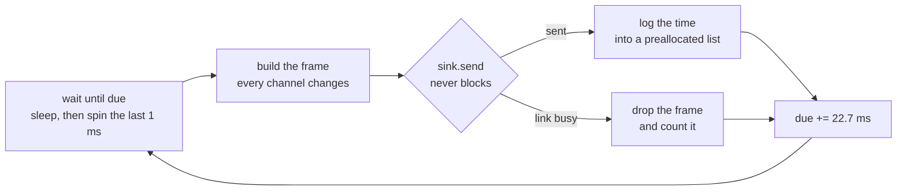

# Spike: glitch-free USB DMX on macOS (#23)

Can this stack send full DMX frames at 44 Hz from a Mac without glitches? Measured on 2026-11-18, MacBook Pro (Apple M1 Max, 10 cores), macOS 27.2. Code: `spikes/dmx-timing/` (throwaway).

## Verdict

| Question | Answer |
|---|---|
| Can a thread hold 44 Hz within 2 ms on macOS? | ✅ Only with the Mach time-constraint policy: 0 of 5279 intervals off, p99 22.73 ms. Default priority and QoS: 38 to 39 % off |
| DMX USB Pro, 10 minutes idle and under heavy CPU load | ✅ p99 22.73 ms, 0 of 26 399 intervals off, 0 frames dropped |
| The same in the background (`taskpolicy -b`) | ❌ about 8 Hz on every sink, p99 about 230 ms, max up to 1.4 s: background policy overrides the time-constraint thread |
| Without a vendor driver | ✅ The FTDI serial driver built into macOS, `libc` only |
| Open DMX (host makes break and timing) | ⏳ written and compiled, not run: no adapter |
| A hidden Tauri window (App Nap) | ✅ measured with the real shell: no window state slows the engine, p99 under 1 ms ([hidden-window.md](hidden-window.md)) |
| Sleep and wake, unplug and replug | ⏳ moved to the real output ticket (#106). The commands below are ready |
| Timing on the DMX wire | ⏳ not measured: needs a DMX analyser |

- **For the product tick:** give the output thread the time-constraint policy. The plain sleep loop is what #101 and #24 saw wake late.
- **Keep the engine process out of the background band.** Under Darwin background policy even the time-constraint thread runs at 8 Hz. Measured in [hidden-window.md](hidden-window.md): a hidden, minimised or covered window does not put the engine there, so nothing more is needed.
- **For the DMX USB Pro:** its USB to widget link is a real serial line. Set it fast enough (500 000 baud) and never write faster than it drains: the first run did not, and frames fell minutes behind while every host number looked perfect (see "What failed").

## The output thread

- One thread per run, raised before the loop. No locks, no allocation in the loop (`tests/no_alloc.rs` counts the thread's allocations: 0).
- Interval = time between two frames handed to the sink. "Off" = more than 2 ms away from 22.727 ms.

## Thread setups (mock sink, 2 minutes each)

| Priority, wait | p50 ms | p99 ms | max ms | off by > 2 ms | late p99 ms |
|---|---|---|---|---|---|
| default, sleep | 22.66 | 29.43 | 90.95 | 1983 (37.6 %) | 10.07 |
| default, spin | 22.64 | 28.47 | 50.20 | 2053 (38.9 %) | 8.95 |
| QoS user interactive, sleep | 22.63 | 27.50 | 48.25 | 2055 (38.9 %) | 5.51 |
| QoS user interactive, spin | 22.67 | 26.76 | 44.02 | 2052 (38.9 %) | 4.20 |
| **time-constraint, sleep** | 22.73 | 22.74 | 22.77 | **0** | 0.02 |
| **time-constraint, spin** | 22.73 | 22.73 | 22.73 | **0** | 0.00 |

- A late wake makes two bad intervals: one long, then one short as the loop catches up. That is why the p50 looks fine and 39 % are off.
- Time-constraint: period 22.7 ms, computation 2 ms, constraint 5 ms (`src/sys.rs`). Spin adds nothing the policy needs; it trims the last 0.02 ms.

## Scenarios (10 minutes each, time-constraint and spin)

Mock, DMX USB Pro and DDP ran at the same time, as three processes. Each cell: p99 / max interval in ms, intervals off by more than 2 ms, frames dropped.

| Scenario | Mock | DMX USB Pro | DDP (WLED) |
|---|---|---|---|
| Idle | 22.73 / 22.75, 0 off | 22.73 / 22.74, 0 off, 0 dropped | 22.73 / 22.76, 0 off, 0 dropped |
| Heavy CPU (10 busy threads on 10 cores) | 22.73 / 22.74, 0 off | 22.73 / 22.74, 0 off, 0 dropped | 22.73 / 22.74, 0 off, 0 dropped |
| Background (`taskpolicy -b`) | 226 / 1043, all 4678 off | 232 / 1042, all 4655 off, 0 dropped | 246 / 1364, all 4625 off, 0 dropped, 18 send errors |

- 26 400 frames per idle and load run. In the background about 4 650: every frame came more than a whole period late, so the loop started over each time instead of sending bursts.
- WLED reported `live` in every `/json` sample while DDP ran (118 of 118 idle, 71 of 71 under load, 118 of 118 in the background).
- "Background" stands in for a hidden window (App Nap): the spike is a command line tool without a window, so it runs under macOS background policy instead.
- Heavy CPU has no UI load: there is no UI in this spike. #24 measured a busy UI next to the engine.

## USB access

| Option | Chosen | Why |
|---|---|---|
| The FTDI serial driver built into macOS (`/dev/cu.usbserial-*`) | ✅ | no install, plain `open`, `write`, `ioctl` through `libc` |
| FTDI's D2XX vendor driver | | an install, and the issue asks for none |
| libusb | | LGPL: not allowed here |
| nusb (pure Rust USB) | fallback | if the built-in driver ever stands in the way, e.g. for Open DMX break timing |

- The port is opened exclusively (`TIOCEXCL`): a second program gets "busy" instead of mixing frames.
- The unsafe code is one file, `src/sys.rs`, every block commented.

## What the host can and cannot see

| Sink | Measured here | Not measured |
|---|---|---|
| DMX USB Pro | when each frame is handed to the driver | when it reaches the widget, and the DMX timing on the wire: the widget makes that itself. Needs a DMX analyser |
| DDP | when each packet is handed to the socket | arrival times: the simulator build in use has no inspection API. Only `live` on `/json` (sampled every 5 s) and its log of rejected packets |
| Open DMX | nothing yet | everything: no adapter |

## What failed

| What | Seen | Cause | Now |
|---|---|---|---|
| DMX USB Pro at 57 600 baud | host intervals perfect (p99 22.73 ms, 0 off), then the 10-minute run took 47 minutes to end, stuck in `close` | the widget link drains about 5 kB/s; 44 frames need 22.8 kB/s. The driver queued about 10 MB out of sight (`TIOCOUTQ` says 0, `tcflush` does not reach it, `TIOCSDRAINWAIT` needs root) | 500 000 baud. Non-blocking writes. The sink tracks when the link is free and drops a frame instead of queueing it. A hard deadline ends every run |
| DMX USB Pro at 3 000 000 baud | the widget dropped off USB and came back | too fast for the widget | not used |
| First request after a run | the widget ignores the first "get parameters" after a run; the second is answered in 3 ms | not found; no backlog, else the second answer would be late | noted, not chased |
| Allocation test | failed now and then with 1 or 2 allocations | it counted the report built after the loop | counts only the output thread until the loop ends |
| DDP pattern in the WLED simulator | a pixel with only white (R, G, B = 0, W = 255) shows black | the simulator's drawing, not DDP | a full-colour rainbow, white 0 |

## DDP: an extra

Not asked for in the issue. It does not replace the DDP output feature (#44).

- One packet per frame: header `0x41`, sequence 1 to 15, `0x1B` (RGBW, 8 bit), device 1, offset 0, length 1280, then 320 pixels. A rainbow moves one column per frame on a 4 × 80 matrix, so a dropped or repeated frame shows.
- The socket is non-blocking. A send that would block drops the frame and counts it: the thread never waits on the network.
- The spike's loopback test (`tests/ddp_loopback.rs`) checks every packet: what is sent, not how fast. CI no longer builds the spike (#110). The product's DDP output is tested in `crates/outputs`.

## Open DMX: written, not run

- Break 110 µs and mark-after-break 16 µs from `TIOCSBRK`, then start code and 512 channels at 250 000 baud, then `tcdrain`.
- 513 bytes × 11 bits at 250 000 baud = 22.6 ms. With break and mark, a full universe does not quite fit into 22.7 ms: expect about 43 Hz.
- It blocks the output thread for most of each frame, by design. Open: whether `tcdrain` waits for the wire, given the hidden driver queue the Pro run showed.

## Open

| Run | Where | Command (in `spikes/dmx-timing/`) |
|---|---|---|
| Unplug and replug | #106 | `cargo run --release -- --sink pro=$(ls /dev/cu.usbserial-* \| head -1) --priority realtime --wait spin --hands unplug --json results/unplug-pro.json` |
| Sleep and wake | #106 | the same with `--hands sleep --json results/sleep-pro.json` |
| Open DMX | #23, needs an Open DMX adapter | `--sink open-dmx=PORT` |
| Wire timing | needs a DMX analyser on the Pro's output | |

`--hands` prints, with a bell, what to do and when.

## Runs

All commands: `spikes/dmx-timing/README.md`. Results as JSON: `spikes/dmx-timing/results/`. Nothing builds the spike in CI: the job `dmx-timing-spike` was removed in #110. Its last run, for the record only: 20 seconds with a mock sink on Linux and macOS. The macOS runner (a virtual machine, time-constraint) had 13 of 879 intervals off, p99 24.6 ms; Linux 0.
