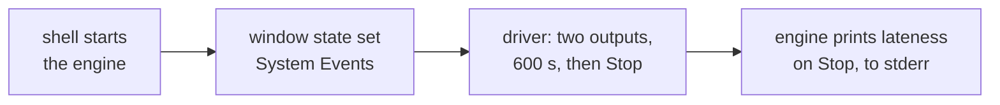

# Measured: a hidden window does not slow the engine (#107)

Does the window's state touch the output thread? Measured on 2026-11-18, MacBook Pro (Apple M1 Max, 10 cores), macOS 27.2, release build, the real shell (`target/release/bossylights`), which started the engine as its child.

## Verdict

| Window | Front app | 60 a second: p99, worst | 44 a second: p99, worst | Frames dropped | Raw |
|---|---|---|---|---|---|
| in front | the shell | ≤ 0.1 ms, ≤ 0.1 ms | ≤ 0.2 ms, ≤ 0.3 ms | 0 of 62 400 | [front.txt](hidden-window/front.txt) |
| behind a window over the whole screen | Finder | ≤ 0.1 ms, ≤ 0.1 ms | ≤ 0.3 ms, ≤ 0.3 ms | 0 of 62 400 | [behind.txt](hidden-window/behind.txt) |
| minimised | the shell | ≤ 0.1 ms, ≤ 0.1 ms | ≤ 0.3 ms, ≤ 0.3 ms | 0 of 62 400 | [minimised.txt](hidden-window/minimised.txt) |
| minimised | Finder | ≤ 0.1 ms, ≤ 0.1 ms | ≤ 0.3 ms, ≤ 0.4 ms | 0 of 62 402 | [minimised-background.txt](hidden-window/minimised-background.txt) |
| another app in full screen | Finder, full screen | ≤ 0.1 ms, ≤ 0.2 ms | ≤ 0.3 ms, ≤ 0.3 ms | 0 of 62 399 | [fullscreen.txt](hidden-window/fullscreen.txt) |

- All p99 under 1 ms. No state slowed the output thread, so the engine process is left as it is: nothing keeps it out of the background band, because nothing put it there.
- Lateness is counted in 100 µs buckets: "≤ 0.3 ms" is the bucket's upper edge.
- Each run is 10 minutes, two DDP outputs at 60 and 44 a second to a receiver on this Mac. Every frame was accepted (`accepted` in the raw files): the counts match about 600 s × the rate.

## How it was run

| Step | Command |
|---|---|
| Build | `cargo build --release -p shell -p engine-server --bins --example hidden_window` and `npm run ui` (the release shell built with cargo loads the dev UI) |
| Start | `target/release/bossylights 2> shell.log` |
| Window | System Events: `frontmost`, `AXMinimized`, a Finder window over the screen, Finder's `AXFullScreen` |
| Drive | `target/release/examples/hidden_window 600`: adds the outputs, waits, prints the counters, sends `Stop` |

## What was not seen

| Not seen | Why |
|---|---|
| The window's content during the runs | a hidden web view does not draw, and nothing was captured. The window's state was read from System Events before and after each run (raw files) |
| The window's state after "behind" and during "full screen" | System Events could not list the shell's window then (`Invalid index`): it lists windows of the current Space only. Finder was the front app before and after |
| A bundled, signed app started from the Dock | the shell was started from a terminal. App Nap and the background band may treat a bundle started by launchd differently. Measure again once the app is bundled |
| Hours, sleep and wake, a busy machine | 10 minutes each, the Mac otherwise idle |
