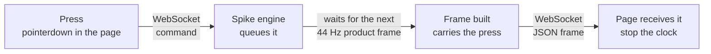

# Spike: control surface at scale (#24)

Can a web UI carry the control surface at show size? Measured on 2026-11-18. Code: `spikes/surface-scale/` (throwaway).

## Verdict

| Target | Chromium | Tauri web view (macOS) |
|---|---|---|
| 60 frames per second sustained | ✅ 120 (the display rate) in every phase, p95 frame 9 ms | ⚠️ 59.6 to 59.8 once running (WebKit caps at 60), with 3 to 10 frames over 25 ms per phase and one 795 ms stall at the start |
| Press to engine frame, p95 under 25 ms | ⚠️ 25.2 ms, on the line (an earlier run: 24.8) | ❌ 29 ms |

- **Drawing is not the problem.** 200 widgets, 100 fixtures and a waveform redraw at the display's rate in both.
- **The 44 Hz tick is the problem.** A press waits for the next engine frame: 22.7 ms apart, and macOS often wakes the tick late. That wait alone is 23.3 to 23.4 ms at p95 in both runs, which leaves less than 2 ms for the rest of the 25 ms.
- **Next step:** decide in "Confirm base and stack" whether the target becomes "one engine frame plus 5 ms", or whether commands should be applied between ticks. Both are engine work, outside this spike.

## What was measured

| On screen | What |
|---|---|
| Surface | 200 widgets (140 buttons, 40 sliders, 20 XY pads) as DOM elements. Drag by the grip, resize by the corner, press or move the body. Mouse and touch through pointer events |
| Rig preview | canvas, 100 fixtures on 4 trusses, a beam and a glow each, colour and intensity from every engine frame |
| Waveform | canvas, the last 6 seconds, 32 peaks per engine frame, scrolling smoothly between frames |
| Engine | the product `Engine` ticks at 44 Hz. A spike binary watches its frame counter every 1 ms, applies queued commands and sends one JSON frame (about 4 KB) per product frame |

## Numbers

Frames per second and frame time, from `requestAnimationFrame`:

| Phase (15 to 20 s each) | Chromium fps | p95 / max ms | Tauri fps | p95 / max ms |
|---|---|---|---|---|
| Idle: rig and waveform only | 119.7 | 9 / 51 | 56.2 | 18 / 795 |
| Dragging one widget | 120.1 | 9 / 9 | 59.8 | 18 / 56 |
| All 200 widgets update every frame | 120.0 | 9 / 9 | 59.6 | 18 / 50 |
| A press every 150 ms | 120.1 | 9 / 9 | 59.6 | 18 / 77 |

Press to the engine frame that carries it (about 130 presses each):

| | p50 | p95 | max |
|---|---|---|---|
| Chromium, page to page | 13.7 ms | 25.2 ms | 30.9 ms |
| Tauri, page to page | 15.0 ms | 29.0 ms | 108 ms |
| Engine wait for the next tick (both runs) | 11.9 to 12.4 ms | 23.3 to 23.4 ms | 27.6 to 29.2 ms |

Engine frames reached both pages at 43.7 to 44 a second. The gap between two frames was 27 to 31 ms at p95 and up to 88 ms (target 22.7), because the macOS tick wakes late (#101: p99 between 8 and 25 ms).

Raw results: `spikes/surface-scale/results/chromium.json`, `tauri.json`.

## Method

| | |
|---|---|
| Machine | MacBook Pro, Apple M1 Max, macOS 27.2. Other work was running on it, so the numbers are not from an idle machine |
| Build | spike engine `--release`. Tauri: the product shell from `tauri dev` (debug shell; WebKit draws in its own process). Chromium 158 from Playwright 1.65, with a visible window and background throttling turned off |
| Window | 1440 x 900 at 2x in Chromium. Tauri: 1440 x 900 window, 1440 x 868 page at the start and 1920 x 1018 by the end: the window was resized during the run, not by the spike |
| Length | about 75 s per run: 3 s warm-up, then idle 15 s, drag 15 s, update 15 s, presses 20 s |
| Press timing | the page sends itself a `pointerdown` on a random button. The clock starts at the event's time stamp and stops when the WebSocket message whose `acks` holds that press arrives. Input-device latency and the paint after it are not included |
| Frame time | interval between `requestAnimationFrame` callbacks |

## What was tried

| Try | Result |
|---|---|
| DOM widgets moved with `transform`, values applied only when they change | cheap enough: all 200 updating costs no frames in Chromium |
| First Chromium run, before the page logged its phases | 125 to 130 fps, press p95 24.8 ms, two single frames of 150 and 206 ms. Replaced by the run above, made with the committed code |
| Canvas for the rig and the waveform, redrawn every paint | fine in both |
| First Tauri run | no result and no log, window stopped by hand after about 6 minutes. Most likely cause, not proven: the drag phase waited for paint callbacks that never came (a capture of the window showed no content). Second run: the page logs each phase to the engine, never waits longer than 100 ms for a paint, and the run stops 115 s after the window opens |
| Tauri window on top (`alwaysOnTop`) for the timed run, CSP off, page from the spike server | measured in the product shell, `shell/` unchanged |

## Run it

| Where | Command |
|---|---|
| Browser (Chromium from Playwright) | `node spikes/surface-scale/run.mjs browser` |
| Tauri shell | `node spikes/surface-scale/run.mjs tauri` |
| Timed measurement | add `--measure`: writes `results/<chromium or tauri>.json`, then stops everything |
| Drag, resize and press by mouse and by touch | `npx playwright test -c spikes/surface-scale` (8 checks, passing) |

The spike is outside the Cargo workspace and outside `npm test`.
