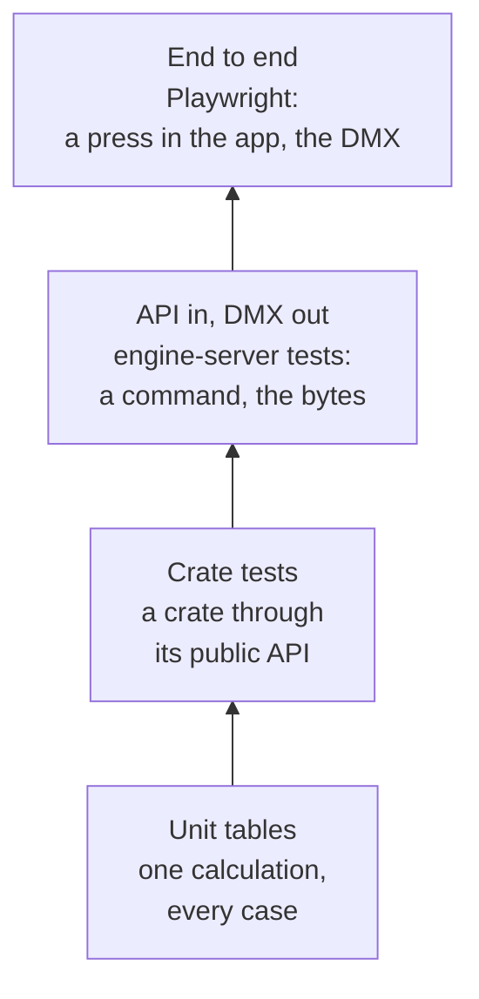

# Which test proves what

A test proves its subject's expected behaviour. Where a higher test already proves a piece, the lower test can be narrower. Measured, never guessed (#300).

| Layer | Proves | Breadth |
|---|---|---|
| Unit table (`#[cfg(test)]`, `ui/src/*.test.mjs`) | one calculation or state machine: every row, every edge | full: every case of the table |
| Crate test (`crates/*/tests`) | the crate's promise through its public API | the cases a caller can tell apart |
| API in, DMX out (`crates/engine-server/tests`) | a command reaches the bytes | one test per feature and per rule |
| End to end (`e2e/`, `ui/src/catalog`) | a press in the app reaches the bytes | one test per feature |

## When a test may go or be narrower

| Condition | Measured by |
|---|---|
| every piece of code it reaches is reached by a test that stays | per-test coverage: one LLVM or V8 profile per test |
| every mutant it kills is killed by a test that stays | kill matrix: `cargo mutants` with every test run per mutant |
| it is in none of the rows below | `KEEP` in `scripts/test-reach.mjs` |
| the tests that cover it are not being rewritten (#250 L3: `engine-core`, `engine`, `rig`) | `REWRITTEN` in `scripts/test-reach.mjs` |
| the bug its name describes, planted by hand, is still caught by the tests that stay | by hand, per candidate: `cargo-mutants` never removes a call such as `.trim()`, so an input edge can look covered when it is not |

Both measured, or the test stays. Its kills are not fully known, so it stays, when:

| Unknown | Why |
|---|---|
| no kill matrix ran its package for every crate it reaches | a mutant there was never tried against it |
| a mutant it reaches timed out, or was caught with no failing test in the log | the log cannot name every killer |
| a failing name matches tests in two packages | the log cannot tell which one failed |

## Never dropped

| Test | Why |
|---|---|
| the end-to-end test that checks the DMX of a feature | AGENTS.md: every feature has one |
| a state machine walk, row by row | docs/coding.md rule 3 |
| real-time: no allocation, timing bounds | docs/coding.md rule 7 |
| expected answers from outside the code that no other test repeats | charts, QLC+, hand-worked tables, saved real output |
| any test that alone kills a mutant | the guard of #300 |
| a test that reaches no measured code | a spawned process or a fact the compiler checks: coverage cannot see it |

## Measure

| Step | Command | Writes |
|---|---|---|
| per-test reach, Rust | `npm run test-reach -- rust` (needs `rustup component add llvm-tools`) | `target/reach/rust.json` |
| per-test reach, node tests | `npm run test-reach -- node` | `target/reach/node.json` |
| kill matrix of one crate | `npm run test-reach -- kills <crate> [<test package>…]` | `target/reach/kills-<crate>.json` |
| report | `npm run test-reach -- report` | `target/reach/report.md`, `removal.json` |

A piece of code is an LLVM region (each side of a branch is its own region) or a V8 byte range. Reached is not checked: only the kill matrix says a test checks what it reaches.
